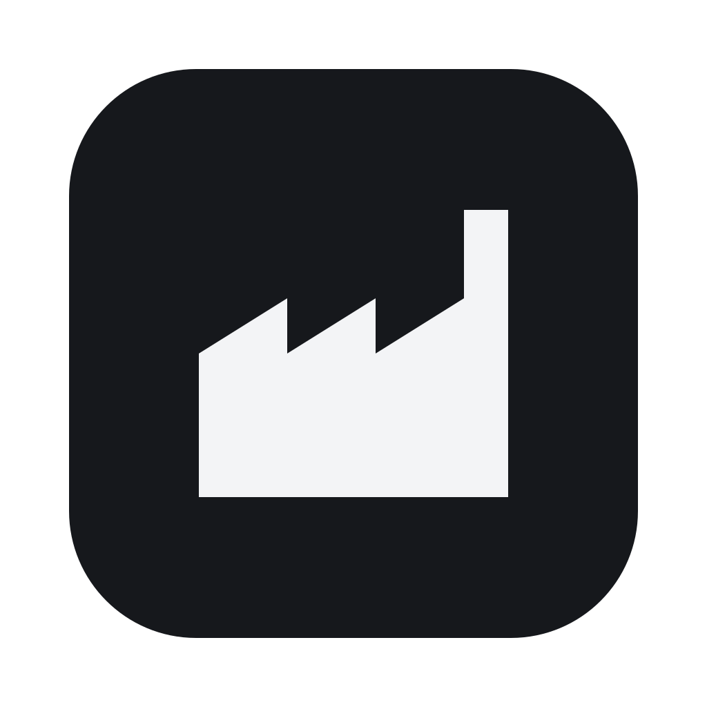
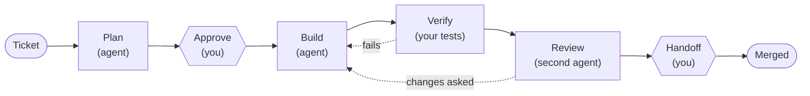
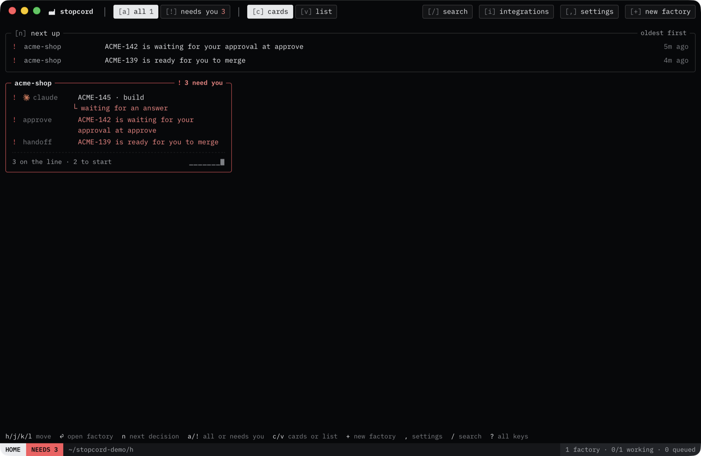
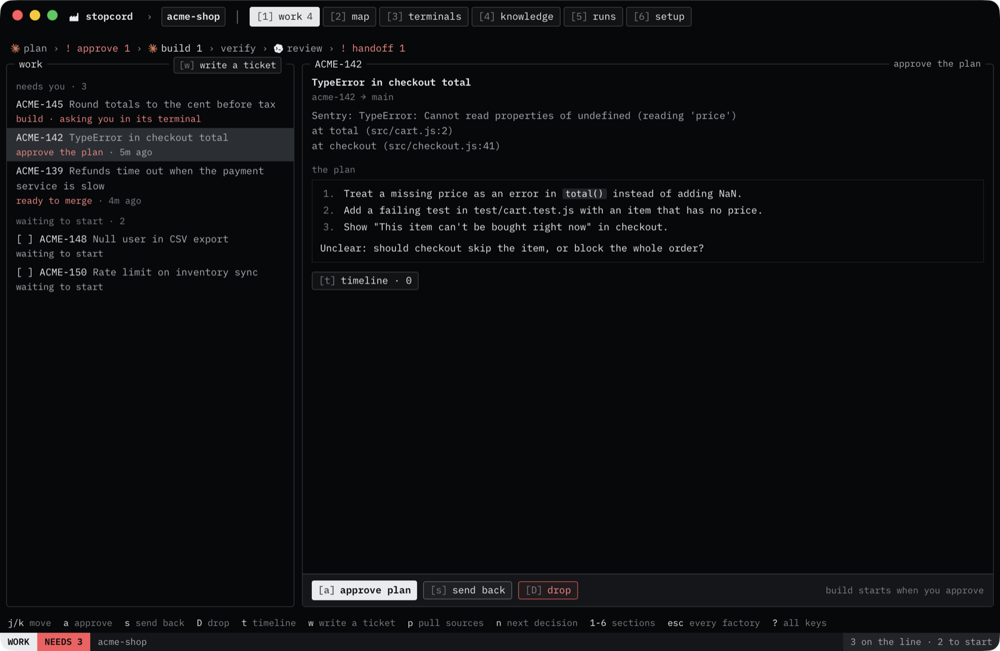
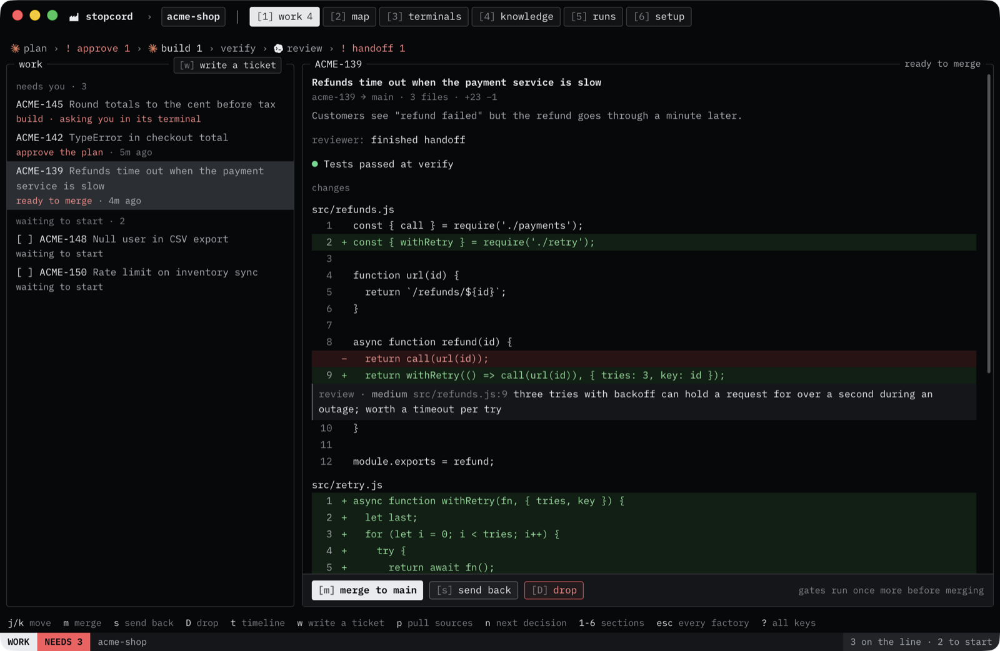
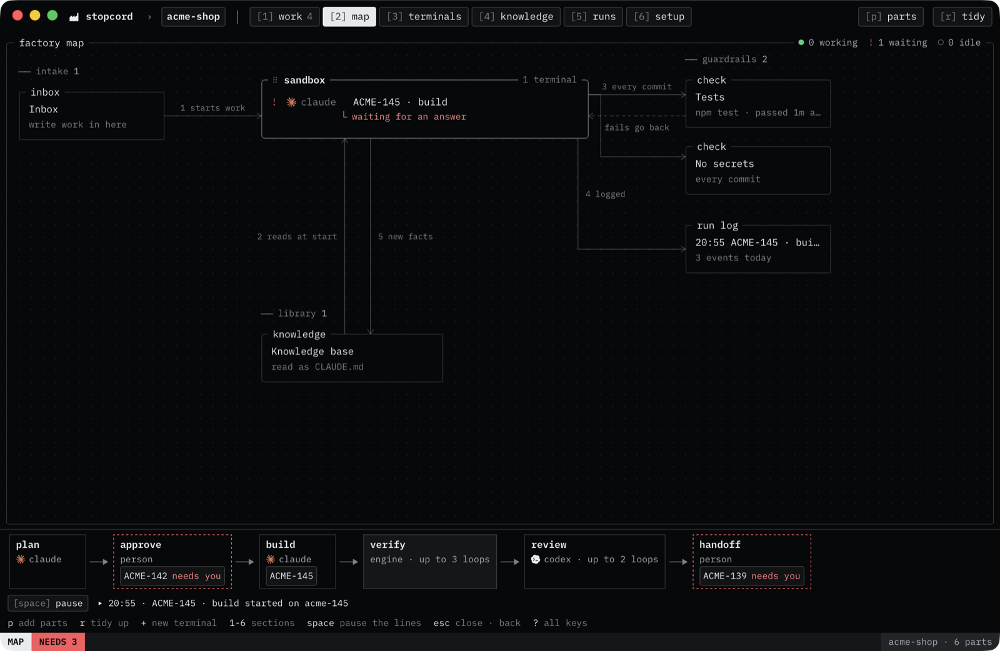

<div align="center">



# Stopcord

**Software factories for your coding agents, on your own Mac.**<br>
Tickets go in. Agents plan, build, test and review on their own branch.<br>
The line stops for you at the points you choose, and nothing merges until you say so.

[](https://github.com/FurkanCodes/stopcord/actions/workflows/ci.yml)


[](LICENSE)

**Install** (Apple silicon Mac):

```sh
curl -fsSL https://raw.githubusercontent.com/FurkanCodes/stopcord/main/scripts/install.sh | bash
```

[Install](#install) · [First ticket](#your-first-ticket) · [Safety](#how-much-agents-are-confined) · [Known gaps](#what-it-doesnt-protect-yet)

</div>

> [!NOTE]
> **Early release.** Stopcord has had one user so far and runs on macOS. Use it on repos you've pushed to a remote, and read [what it doesn't protect yet](#what-it-doesnt-protect-yet) first.

---

## How it works

Each project you add becomes a **factory**. A factory runs every ticket through a **line** of steps. This is the default line:



The builder works on its own branch, in its own folder. Your tests run on a clean copy of its latest commit. A second agent reviews the change. You approve the plan and you decide whether it merges. Everything else runs without you, and the app tells you when something needs you.

You can change every part of this line, or start from a simpler one.

<table>
  <tr>
    <td width="50%"></td>
    <td width="50%"></td>
  </tr>
  <tr>
    <td align="center"><b>Home:</b> what needs you, across every factory</td>
    <td align="center"><b>Approve:</b> read the plan before anything is built</td>
  </tr>
  <tr>
    <td width="50%"></td>
    <td width="50%"></td>
  </tr>
  <tr>
    <td align="center"><b>Handoff:</b> the diff, the tests and the review, then merge</td>
    <td align="center"><b>Map:</b> the factory's parts and its line</td>
  </tr>
</table>

## Why Stopcord

| | |
|---|---|
| 🏭 **One window for every repo** | Every factory, terminal and ticket in one place. The home screen shows what needs you first. |
| ✋ **You decide at set points** | The line stops for a person where you put a stop: the plan, the merge, or anywhere else. |
| 🧪 **Tests the builder can't fake** | Checks run on a clean copy of the commit. Changes to your test files are flagged until you accept them. |
| 🔒 **Contained by default** | Agents run in a macOS sandbox, on their own branch, behind a web filter. [What that covers](#how-much-agents-are-confined). |
| 🔑 **Your agents, your keys** | Use the coding-agent CLIs you already have, signed in with your own account. No server, no extra account. |

**Why not just run Claude Code in a few git worktrees?** You can, and for one repo that works. Stopcord adds what a script doesn't: a planner, a builder and a reviewer that can each be a different agent; gates that run your tests where the builder can't change them; limits on how many times work goes round; and one place that tells you which of your projects is waiting on you.

## Features

- **Lines you design:** add, remove and reorder stages. Each stage is an agent, a check, or a person. Set what happens when a stage fails, and how many times work can go back.
- **Templates:** start a factory as **open** (terminals and a knowledge base), **reviewed** (your tests run on every commit), or **line** (the full ticket line). Save your own factory as a template, export it, and share it.
- **Any agent CLI:** built in for Claude Code, Codex, Gemini CLI, opencode, GitHub Copilot CLI, Cline and Kilo Code. The builder and the reviewer can be different ones.
- **Races:** let several agents take the same stage at once, each on its own copy. One copy that passes the next gate is kept, and the rest are dropped.
- **Tickets from where they already are:** pull them from Sentry, Linear and GitHub, or send them from Slack. Write them by hand too.
- **Triggers:** start an agent when a terminal goes quiet, on a schedule, when a check fails, or when a ticket arrives.
- **A knowledge base per factory:** one notes file every agent reads, as `CLAUDE.md`, `AGENTS.md` or `GEMINI.md`. Agents can add to it, and you review what they add.
- **Terminals that keep running:** a background daemon owns every terminal, so work goes on with the window closed. It reads each screen to tell whether the agent is working, waiting or asking you something.
- **Reports:** post to Slack, or run your own command, when a ticket needs you, fails, merges or is dropped.
- **Three ways to confine agents:** a git worktree, a macOS sandbox with a web filter, or a Linux container in Docker.

## Install

**You need:**

- a Mac with Apple silicon (M1 or later). Tested on macOS 26.
- git, and a repo with at least one commit
- at least one coding-agent CLI, installed and signed in. Claude Code is the one tested most.
- Docker, only for the `vm` level

**Then, in Terminal:**

```sh
curl -fsSL https://raw.githubusercontent.com/FurkanCodes/stopcord/main/scripts/install.sh | bash
```

The script downloads the latest release, checks it against its SHA-256 checksum, and puts `Stopcord.app` in `/Applications`. [Read it](scripts/install.sh) before you run it.

Stopcord isn't notarized yet: that needs a paid Apple Developer account, which this one-person project doesn't have yet. So the script asks you one question:

- **yes:** skip Apple's check, and Stopcord opens right away.
- **no:** keep Apple's check. macOS blocks Stopcord the first time it opens. Click **Done**, then go to System Settings → Privacy & Security and click **Open Anyway**.

You get the same app either way. To update, run the command again. Your factories and the agents working in them carry on.

Or download `Stopcord-<version>.zip` from [Releases](https://github.com/FurkanCodes/stopcord/releases), check it with `shasum -a 256 -c Stopcord-<version>.zip.sha256`, and move `Stopcord.app` to Applications.

<details>
<summary><b>Build from source</b> (Intel Macs, Linux, or to work on Stopcord)</summary>

You also need Rust through [rustup](https://rustup.rs), which installs the version the repo pins, Node.js 22 or later, and Xcode's command line tools (`xcode-select --install`).

```sh
git clone https://github.com/FurkanCodes/stopcord.git
cd stopcord
npm ci
cd app
npx tauri build --bundles app
```

The app is at `target/release/bundle/macos/Stopcord.app`. An app you build yourself isn't blocked by Gatekeeper.

To work on Stopcord itself, run `npm run app` from the repo root instead. That starts a debug build that reloads as you edit. To make a release zip, run `scripts/package.sh`.

</details>

## Your first ticket

1. On the home screen, choose **new factory** and pick your repo's folder.
2. Under **start**, choose **line**. Pick the agent that builds and the one that reviews, and keep **runner** at **contained**.
3. Write a small ticket, for example a one-line bug fix with a test.
4. Read the plan, then approve it or send it back with a note.
5. Wait. Each step shows in the window, and the app asks you only when a stage needs a person.
6. At handoff, read the diff and merge it, or send it back.

**Cost:** each ticket runs at least three agent sessions (planner, builder, reviewer), billed to your own subscription or API key. Verify can send work back up to 3 times and review up to 2, so a hard ticket can take about 8 sessions. The default line works on 2 tickets at once.

## How much agents are confined

| Level | The agent gets | What's protected |
|---|---|---|
| `worktree` | Its own folder and branch. No sandbox. | A git hook stops it moving your checked-out branch. Otherwise it can do anything your user can. |
| `contained` (default) | Its own folder and branch, in the macOS sandbox, with web traffic through a filter. | The list below. |
| `vm` | A Linux container in Docker, with a copy of the folder. | No mounts of your folders, no Docker socket, no network except the filter. Work comes back through git. |

<details>
<summary><b>What an agent at <code>contained</code> can and can't do</b></summary>

An agent at `contained`:

- writes only to its own worktree, the parts of `.git` a commit needs, its agent CLI's config folders, tool caches, temporary folders, the factory's knowledge file, and folders you add.
- can't read `~/.ssh`, `~/.aws`, `~/.gnupg`, `~/.config/gcloud`, `~/.kube`, `~/.docker/config.json`, `~/.netrc`, `~/.npmrc`, your shell history or Stopcord's own secrets.
- can't move the branch your project had checked out when its terminal started, and can't change `.git/hooks` or `.git/config`.
- reaches only the web sites its agent needs, the ones you allow, and ports on your own machine. It can't reach Stopcord's sockets or Docker's.
- can't write `~/.zcompdump` or the `claude` program in `~/.local/share/claude`, which your own shell and Claude Code run later.

Checks run in the same kind of sandbox, with no network unless the check asks for it. Stopcord's own git commands run with your repo's hooks, fsmonitor and replace refs off.

To see it for yourself: in a factory's **setup** tab, under **sandboxes**, **test this sandbox** tries each of these from inside and shows what was blocked.

</details>

<details>
<summary><b>What creating a factory changes in your repo</b></summary>

- **Branches and worktrees.** Each ticket gets a branch named after it, checked out in a worktree under `~/.stopcord/`. Your own checkout stays as it is until you merge.
- **Git hooks.** If the factory has checks that run on commit (the **reviewed** and **line** starts add your tests and a secrets check), Stopcord installs a `pre-commit` hook that runs them on your own commits too. Checks set to run before a merge get a `pre-push` hook. Every factory also adds a `reference-transaction` hook that stops work in a ticket's worktree from moving your checked-out branch. If your repo sets `core.hooksPath` (husky does), or already has a hook with that name, Stopcord leaves it alone and says so.
- **The knowledge base.** Stopcord makes the factory's notes readable as `CLAUDE.md`, `AGENTS.md` and `GEMINI.md`. A file you don't have becomes a link, listed in `.git/info/exclude` so it's never committed. A file you already have gets a short marked block at the end, which shows in `git status`. Removing the factory takes both back.
- **Merging.** Stopcord merges with `git merge --no-ff` in your project, with git hooks off, so hooks a ticket's branch changed don't run. Your own merge hooks don't run for these merges either.

</details>

## What it doesn't protect yet

These are known gaps at `contained`. They're listed so you can decide what to give an agent.

- **Other branches, tags and the stash.** Only the branch your project had checked out is protected. An agent can delete your other branches and drop your stash. Push anything you'd miss.
- **Git history.** An agent can delete objects in `.git/objects`. A pushed remote is the copy that survives that.
- **Some of Claude Code's config.** An agent can change `~/.claude.json` (including its MCP servers), `~/.claude/plugins`, `~/.claude/agents`, `~/.claude/commands` and `~/.claude/CLAUDE.md`. Your next Claude Code session outside Stopcord uses them.
- **Shared caches.** An agent can change `~/.cargo/registry`, `~/.npm` and `~/.cache`. Code in an unpacked crate there runs at your next `cargo build`.
- **Renaming git's folders.** Whether the sandbox stops an agent renaming `.git/refs/heads` or a folder in `.git/worktrees` hasn't been tested.
- **Folders that aren't git repos.** Allowed, but the agent works in the folder itself.
- **Linux.** It builds, but the sandbox (bubblewrap) hasn't been tested on a real machine.
- **Machines that can't sandbox.** A contained terminal won't start, but checks run without a sandbox.

## Words used here

| Word | Meaning |
|---|---|
| **Factory** | One project folder in Stopcord, with its terminals, notes, checks and tickets. |
| **Line** | The steps a ticket goes through in a factory. |
| **Stage** | One step of a line, handled by an agent, a check, or a person. |
| **Gate** | A stage that runs checks, such as your tests, on a clean copy of the latest commit. |
| **Runner** | Where a factory's agents run, and how much they're confined. |
| **Harness** | The coding-agent CLI a stage runs, such as `claude` or `codex`. |

## Feedback and contributing

Tried it? Open a **[first run report](https://github.com/FurkanCodes/stopcord/issues/new?template=first-run-report.yml)** saying how far your first ticket got and where it stopped. It's the most useful thing you can send.

- [Contributing](CONTRIBUTING.md): building, checks, and signing off commits
- [Security](SECURITY.md): report a way out of the sandbox privately
- [Docs](docs/README.md): how the daemon, the sandbox and the VM runner work

## Credits

Screen detection rules are adapted from [herdr](https://github.com/herdrdev/herdr). The window uses [IBM Plex Mono](https://github.com/IBM/plex). See [NOTICE](NOTICE).

## License

[Apache License 2.0](LICENSE)
